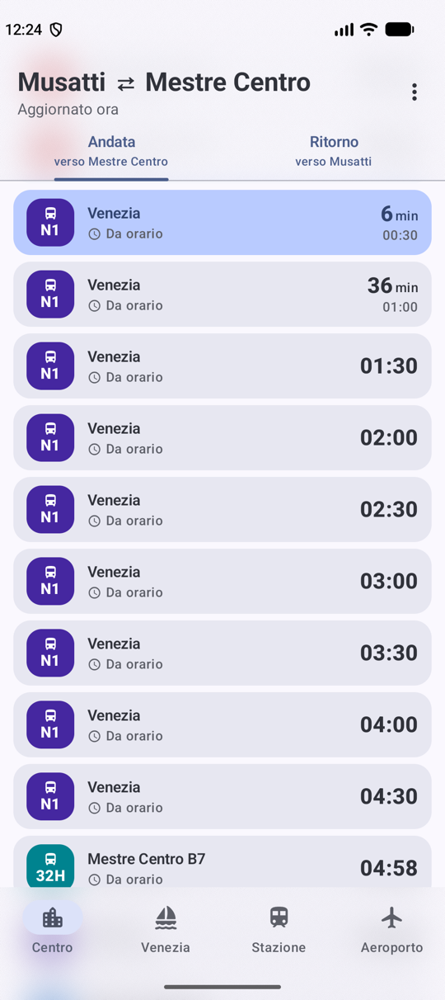
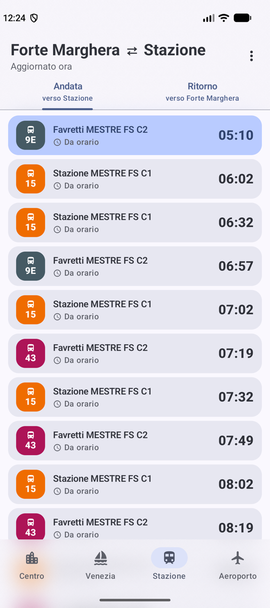
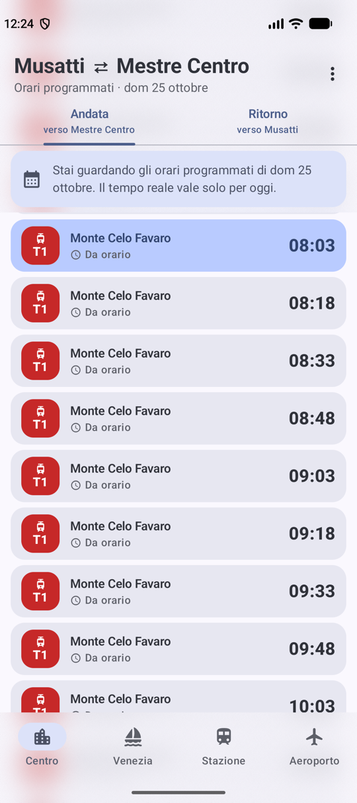
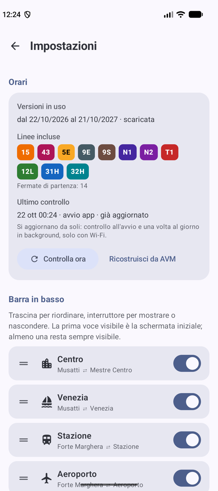

<p align="center">
  
</p>

<h1 align="center">Catchit</h1>

<p align="center">
  Gli orari di autobus e tram di Venezia e Mestre, in tempo reale, a portata di pollice.<br>
  App Android moderna (Jetpack Compose, Material 3 Expressive) costruita sui dati aperti di AVM/ACTV.
</p>

<p align="center">
  
  
  
  
</p>

## Cosa fa

Catchit risponde a una domanda sola: **tra quanto passa il prossimo mezzo che mi serve?**

Non mostra tutta la rete ACTV, che sarebbe un'enciclopedia: mostra solo le linee che collegano direttamente alcuni posti che ti interessano, a partire dalla fermata dove ti trovi. Oggi sono quattro, nella barra in basso:

| Voce | Da | A |
|---|---|---|
| **Venezia** | San Marco Musatti | Venezia (Piazzale Roma / Corsia C) |
| **Centro** | San Marco Musatti | Mestre Centro |
| **Stazione** | Forte Marghera | Stazione di Mestre |
| **Aeroporto** | Forte Marghera | Aeroporto Marco Polo |

Ogni voce ha due schede, **Andata** e **Ritorno**: l'andata sono le partenze dall'origine verso la meta, il ritorno le partenze dalla meta verso l'origine. Le linee sono quelle che fanno davvero il collegamento senza cambi: le ricava il codice dal feed AVM, non una lista scritta a mano.

## Cosa può fare

- **Prossimi passaggi in una lista**: da adesso a 6 ore avanti (anche oltre la mezzanotte, con l'etichetta *domani*), e gli ultimi 15 minuti scorrendo verso l'alto. La lista si apre sempre sulla prossima corsa.
- **Tempo reale** dove AVM lo pubblica: minuti mancanti, ritardo o anticipo rispetto all'orario, corse soppresse. Si aggiorna ogni 20 secondi, solo mentre l'app è aperta (nessun servizio in background, nessun consumo da fermo).
- **Dettaglio della corsa**: toccando una card si apre una scheda con partenza e **arrivo a destinazione** (previsto dal tempo reale quando c'è), durata, **fermate intermedie** con gli orari, dove si trova il mezzo adesso (distanza dalla tua fermata, per le corse live), le corse successive della linea e un pulsante per condividere.
- **Orari programmati** per tutto il resto, mescolati ai passaggi live senza duplicati.
- **Un colore per ogni linea**, uguale per bus e tram della stessa linea: le liste si leggono a colpo d'occhio (ACTV dipinge tutte le linee urbane dello stesso rosso).
- **Altri giorni**: dal menu a tre puntini scegli un giorno e un'ora (da oggi alla fine dell'orario in vigore) e vedi l'orario programmato di quel giorno, con la lista aperta all'ora scelta. «Torna a oggi» (la voce col numero del giorno) riporta subito al presente.
- **Orari sempre aggiornati, da soli**: all'avvio e una volta al giorno l'app chiede ad AVM se ha pubblicato un nuovo orario; se sì lo scarica (solo con Wi-Fi), lo filtra sul telefono e lo installa in background, senza rallentare l'uso. Un nuovo orario pubblicato in anticipo non sostituisce quello in vigore prima della sua data di inizio.
- **Impostazioni**: informazioni su versioni, linee e fermate in uso; pulsante per forzare il controllo degli orari; riordino e visibilità dei pulsanti della barra in basso (la prima voce visibile è la schermata iniziale); un registro degli ultimi 50 eventi (aggiornamenti degli orari, errori del tempo reale) che si può **copiare o condividere** per segnalare un problema.
- **Grafica**: Material 3 Expressive con colori dinamici dallo sfondo (Android 12+), intestazione e barra in basso in vetro traslucido con la lista che scorre dietro, card compatte, tema chiaro e scuro.
- **Funziona anche senza rete**: con gli orari programmati, avvisando che il tempo reale non è disponibile.

> Cosa non fa (ancora): il **tram T1/T2 non ha il tempo reale**. Nel feed pubblico di AVM i tram compaiono solo come posizioni GPS (`TRAM_01…`), senza la corsa a cui appartengono, quindi per ora si vedono gli orari programmati. Vedi [Idee](#idee).

## Come funziona

```
AVM/ACTV ── actv_aut.zip (GTFS, ~14 MB) ──► TimetableBuilder ──► timetable.json (~60 KB)
        └── tpl.actv.it/aut/GTFSRT/tripUpdates (GTFS-RT, ~50 KB) ──► TripUpdatesParser
                                                                         │
                          orari programmati  +  previsioni live ─► DepartureMerger ─► lista
```

- **Dati statici.** Lo zip GTFS di AVM ha 97 linee e 625 mila passaggi; l'app ne tiene una frazione. Il modulo `:timetable-builder` legge lo zip in streaming e conserva solo le corse che collegano direttamente origine e meta (in entrambi i versi). Lo stesso codice genera l'asset incluso nell'APK (`:tools:importer`) e, sul telefono, gli aggiornamenti.
- **Tempo reale.** `tripUpdates` è un file protobuf pubblico; invece di una libreria c'è un piccolo lettore del formato (`ProtoReader`). Contiene, per ogni corsa, l'orario previsto a ogni fermata e il ritardo.
- **Unire i due.** Gli identificativi delle corse nel feed live contengono la versione dell'orario (`AUT_ACTV_792_…`) e cambiano a ogni pubblicazione, quindi non si possono collegare a quelli dello statico. `DepartureMerger` abbina una previsione a una corsa programmata per linea, fermata e *orario previsto meno ritardo* (±2,5 minuti); ciò che resta senza abbinamento si mostra com'è.
- **Versioni degli orari.** `Timetable` tiene più versioni (quella nell'APK e quelle scaricate) e risponde ogni giorno con quella in vigore quel giorno.

## Per sviluppatori

Requisiti: Android SDK 37; il JDK lo scarica Gradle da solo (toolchain in `gradle/gradle-daemon-jvm.properties`).

```bash
./gradlew :app:installDebug                      # compila e installa sul dispositivo/emulatore
./gradlew :app:testDebugUnitTest :timetable-builder:test   # test
./gradlew :tools:importer:run                    # rigenera app/src/main/assets/timetable.json
./gradlew :tools:importer:run --args=--refresh   # idem, riscaricando lo zip AVM
```

Eseguire l'importer **prima**, in un comando separato, e poi compilare l'app: l'app non dipende dall'importer e altrimenti impacchetta l'asset vecchio.

### Cambiare fermate e destinazioni

Tutto è in `timetable-builder/src/main/kotlin/.../TimetableConfig.kt`: ogni destinazione ha un'origine e una meta, descritte da un `Place` (fermate per id, per nome esatto o per prefisso del nome). Per aggiungere un posto basta una voce, rigenerare l'asset e, per le linee nuove, aggiungere un colore in `ui/theme/LineColors.kt`.

> La fermata «Forte Marghera» usata per Stazione e Aeroporto è *Hermada* (`172`/`1172`): nel feed non esiste una fermata chiamata «uffici giudiziari», è una scelta da verificare.

### Struttura

```
app/                  l'app Android (Compose, Hilt, Haze)
  data/               modelli, Timetable, repository, lettore protobuf, log, preferenze
  domain/             Departure e DepartureMerger (orari + live)
  update/             aggiornamento degli orari (updater, worker giornaliero)
  ui/                 board (schermata principale), settings, tema, colori delle linee
timetable-builder/    GTFS → timetable.json (JVM puro, usato da app e importer)
tools/importer/       genera l'asset incluso nell'APK
docs/                 icona, screenshot, proposte grafiche
```

Stack: Kotlin 2.4, AGP 9.4, Compose + Material 3 (1.5 beta per le API Expressive), Hilt, WorkManager, kotlinx.serialization, [Haze](https://github.com/chrisbanes/haze) per il vetro. `minSdk 26`. L'interfaccia è solo in italiano.

Altre note per chi lavora sul codice (formato dei dati, limiti del feed, regole dell'aggiornamento) sono in [`CLAUDE.md`](CLAUDE.md).

## Idee

- **Tram in tempo reale**: stimare l'arrivo di T1/T2 dalla posizione GPS, dalla direzione e dalle fermate della linea, segnandolo come «stimato».
- Widget con il prossimo passaggio.
- Aggiornamento dei dati anche per la navigazione (vaporetti), che usa lo stesso formato.

## Dati e licenza

Gli orari sono i [dati aperti di AVM/ACTV](https://actv.avmspa.it) (GTFS e GTFS-Realtime). Catchit non è un'app ufficiale e non è affiliata ad AVM. Il codice è rilasciato con licenza [GPL-3.0](LICENSE).
